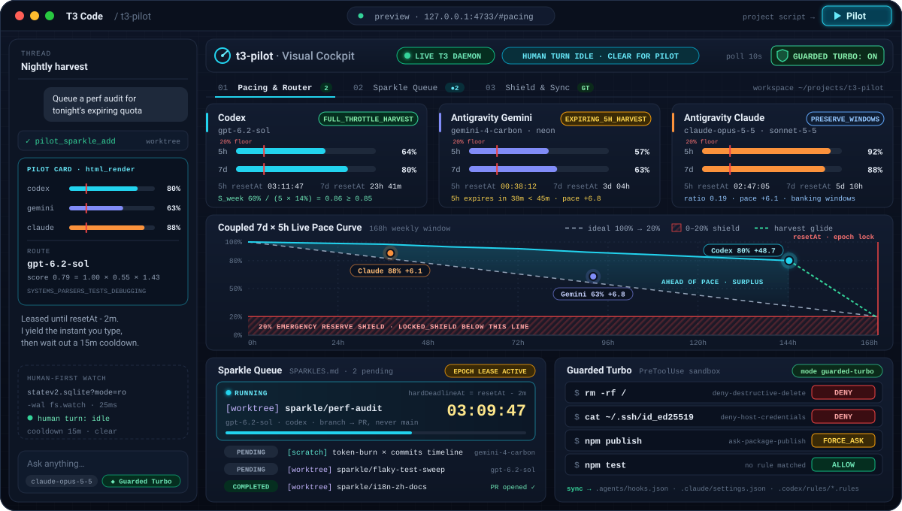
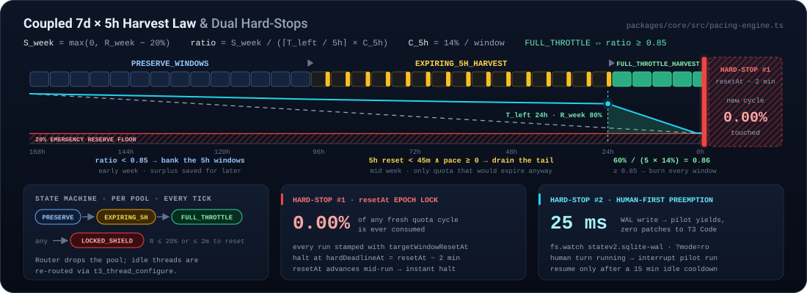
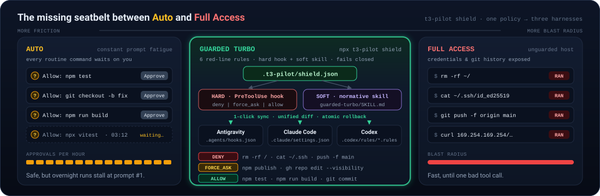
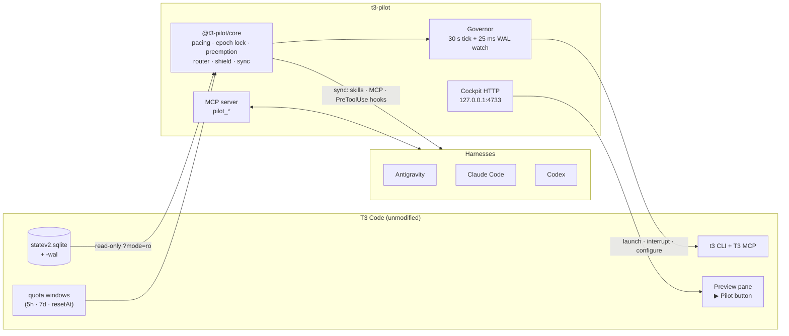

<div align="center">



# t3-pilot

**Turn expiring AI quota into morning surprises, without touching 1% of your fresh cycle.**

An autopilot for [**T3 Code**](https://github.com/pingdotgg/t3code). It routes each task to the model that fits it and still has quota to spare, keeps a 20% emergency reserve, spends quota that would otherwise expire on your backlog, and puts a cross-harness seatbelt on unattended agents.

**English** | [简体中文](./README.zh-CN.md)

[](https://github.com/AgoodNA/t3-pilot/actions/workflows/ci.yml)
[](https://agoodna.github.io/t3-pilot/?demo=1)
[](./vitest.config.ts)
[](./package.json)
[](./LICENSE)

[Quickstart](#-10-second-quickstart) · [Features](#-the-three-killer-features) · [Cockpit](#-visual-pilot-cockpit--inline-chat-cards) · [CLI & MCP](#-cli--mcp-reference) · [Safety](#-architecture--safety-guarantees) · [**Try the demo →**](https://agoodna.github.io/t3-pilot/?demo=1)

</div>

---

## 🤔 Why `t3-pilot`?

If you code with several AI subscriptions in T3 Code (Claude, ChatGPT/Codex, Antigravity Gemini), each one meters you with a **5-hour window** and a **7-day window**. Most people end up in one of three bad weeks:

| | The week | What it costs |
|---|---|---|
| 🐿️ **The Hoarder** | You save quota "just in case" all week. | On Sunday night `resetAt` arrives and **~45% of the week disappears unused**. |
| 🔥 **The Burner** | You go hard on Tuesday. | By Thursday you're at **`0%`, halfway through a debug session**, and stuck waiting. |
| 🎰 **The Gambler** | You switch to **`Full Access`** so the overnight run won't stall on prompts. | Then you lie awake wondering about `rm -rf`, `~/.ssh` and `git push --force main`. |

`t3-pilot` fixes all three. It reads T3 Code's own quota telemetry **read-only**, works out exactly how much of each pool can be spent before it expires, spends only that on work you queued, and stops before your fresh cycle begins.

> [!NOTE]
> `t3-pilot` never patches T3 Code. It reads `statev2.sqlite` with `?mode=ro` and changes threads/projects **only** through the official `t3` CLI and T3 MCP tools.

---

## ⚡ 10-Second Quickstart

```bash
npx t3-pilot init   # scaffold .t3-pilot/, SPARKLES.md, Guarded Turbo policy + register the Pilot button
npx t3-pilot up     # governor + Visual Cockpit on http://127.0.0.1:4733
```

That's all. `init` also adds a **`▶ Pilot`** project script to T3 Code's top bar (`npx t3-pilot up --port 4733`). Clicking it opens the Cockpit in T3's Preview pane. It works the same on **macOS, Windows, a remote Linux VPS over SSH, and T3 Connect mobile preview**.

<details>
<summary><b>What <code>init</code> writes</b> (each file is created only if it doesn't exist yet, or with <code>--force</code>)</summary>

| Path | Purpose |
|---|---|
| `.t3-pilot/config.json` | Pacing config: `reserveFloorPercent: 20`, `singleWindowCapacityPercent: 14`, `fullThrottleRatioThreshold: 0.85`, `expiringSessionThresholdMins: 45`, `epochSafetyMarginMins: 2`, `cooldownMinutes: 15`, `tickIntervalMs: 30000` |
| `SPARKLES.md` | Your Sparkle Queue, a plain Markdown checklist |
| `.t3-pilot/shield.json` | Guarded Turbo policy (`mode: guarded-turbo`, protected branches `main`, `master`, `production`, `release/*`) |
| `.t3-pilot/skills/guarded-turbo/SKILL.md` | Generated soft-guard skill (hash-stamped, regenerated on policy change) |
| `.t3-pilot/skills/pilot-autopilot/SKILL.md` | Sample skill that is synced to every harness |
| `.t3-pilot/mcp.json` | Registers `npx t3-pilot mcp` as an MCP server for every harness |

Flags: `--port <n>` · `--project-id <id>` · `--base-branch <ref>` · `--no-install-script` · `--force` · `--json`
</details>

> [!TIP]
> No daemon? Open the **[Interactive Demo](https://agoodna.github.io/t3-pilot/?demo=1)**. It's the same Cockpit with an offline simulation engine and four scenarios you can switch between: *Early-Week Cruise*, *&lt;45m Expiring 5h Harvest*, *24h Left · 80% Full-Throttle*, *&lt;=20% Reserve Shield Locked*.

---

## 🚀 The Three Killer Features

### 1. Coupled `7d × 5h` Expiring-Quota Sparkle Harvester + `resetAt` Zero-Fresh-Quota Iron Law



The two windows depend on each other. A 5h window caps how fast you can spend, and the 7d window caps how much you can spend in total. Late in the week, the number of 5h windows you have left may not be enough to use up what remains of the weekly quota, even if you run flat out. Waiting for "Sunday night" is already too late at that point. `t3-pilot` checks for that moment on every tick, for every pool:

```text
S_week  = max(0, R_week − 20%)                   # weekly surplus above the reserve floor
N_5h    = ⌈T_left / 5h⌉                          # 5h windows left before weekly resetAt
ratio   = S_week / (N_5h × C_5h)                 # C_5h = 14% of weekly quota per maxed 5h window

ratio ≥ 0.85                                     → FULL_THROTTLE_HARVEST
5h resetAt < 45m  ∧  weekly pace ≥ 0  ∧  S_5h > 0 → EXPIRING_5H_HARVEST
R_week ≤ 20%  ∨  R_5h ≤ 20%  ∨  ≤ 2m to a reset  → LOCKED_SHIELD
otherwise                                        → PRESERVE_WINDOWS
```

**Worked example:** 24h left, 80% weekly remaining → `S_week = 60%`, `N_5h = ⌈24/5⌉ = 5`, max drain `= 5 × 14% = 70%` → `ratio = 0.857 ≥ 0.85` → **full throttle**. Even at maximum pace you'd struggle to spend it all, so every remaining window gets used.

**The Sparkle Queue** is where that surplus goes. Write ideas into `SPARKLES.md` (or the Cockpit, or the `pilot_sparkle_add` MCP tool):

```markdown
- [ ] [worktree] Audit cockpit bundle size and open a PR with the wins
- [ ] [scratch]  Prototype an interactive visual timeline of multi-agent token burn vs git commits
```

| Mode | Where it runs | What you get in the morning |
|---|---|---|
| `[worktree]` | A fresh git worktree on branch `sparkle/<slug>` from your base branch (default `main`) | A branch/PR to review. **Never touches `main`.** |
| `[scratch]` | An isolated folder `.t3-pilot/scratch/<slug>/`, registered as its own T3 project | Research reports, throwaway prototypes, demos |

**Two absolute hard-stops** guard every run:

1. **`resetAt` Epoch Lock: 0.00% of a fresh cycle, guaranteed.** Each run is stamped with the reset times of the windows it's spending (`targetWindowResetAt`) and given a `hardDeadlineAt = min(resetAt) − 2 min`. It halts at that millisecond, or immediately if T3 reports that `resetAt` advanced mid-run. The 2-minute margin is a **floor**: config can widen it but never shrink it.
2. **Human-First Instant Preemption: ~25 ms.** The governor `fs.watch`es `statev2.sqlite`, `-wal` and `-journal`, debounced at **25 ms**. As soon as a non-pilot human turn shows up in T3's projection tables, the pilot run is interrupted. It resumes only after a **15-minute** idle cooldown. You never compete with your own autopilot.

### 2. Guarded Turbo (`t3-pilot shield`): The Missing Seatbelt Between `Auto` and `Full Access`



`Auto` asks permission for `npm test`, which stalls overnight runs. `Full Access` happily runs `cat ~/.ssh/id_ed25519`. **Guarded Turbo** lets routine work run at full speed and puts six red lines around the rest. Each line is enforced twice:

- **Hard layer:** a `PreToolUse` hook (`.t3-pilot/hooks/guarded-turbo-hook.mjs`) that parses the shell command properly. It splits `&&`/`;`/`|` chains, unwraps `sudo`/`env`/`bash -c`, recurses into `$(…)`, and normalises `~`/`$HOME`/`..`. Then it returns `allow`, `deny` or `force_ask`. **It fails closed:** if the payload can't be evaluated, the answer is `deny`.
- **Soft layer:** a generated `guarded-turbo/SKILL.md` that tells the agent what's off-limits *before* it tries.

| Rule ID | Default | Catches (examples) |
|---|---|---|
| `deny-destructive-delete` | 🛑 `deny` | `rm -rf /`, `~`, `..`, `.git`; `mkfs*`; `dd of=/dev/…`; `find / -delete`; `git clean -fdx` on root/home/repo |
| `deny-host-credentials` | 🛑 `deny` | `~/.ssh`, `~/.aws`, `~/.gnupg`, `.netrc`, `.npmrc`, `.pypirc`, `.kube/config`, `gh/hosts.yml`, `.docker/config.json`, `/etc/shadow`, `/etc/sudoers`, `169.254.169.254`, `metadata.google.internal` |
| `deny-force-push-protected` | 🛑 `deny` | `git push --force`/`-f`/`--force-with-lease`/`--delete`/`+ref`/`:ref` to protected branches, `--mirror`, `git branch -D main` |
| `deny-foreign-containers-and-firewall` | 🛑 `deny` | `ufw`/`iptables`/`nft`/`firewall-cmd` mutations, `systemctl stop|disable|mask|kill`, `shutdown`/`reboot`, `docker|podman system/volume prune`, `rm`/`stop`/`kill` on containers outside `t3-pilot*` |
| `ask-package-publish` | ✋ `force_ask` | `npm`/`pnpm`/`yarn`/`bun`/`cargo`/`poetry publish`, `twine upload`, `docker push`, `gh release create` |
| `ask-public-repo-visibility` | ✋ `force_ask` | `gh repo create --public`, `gh repo edit --visibility`, `gh repo delete|archive`, `gh secret set|delete|remove` |

One policy file, **`.t3-pilot/shield.json`**, compiles into each harness's native format:

| Harness | Hard enforcement | Soft guidance |
|---|---|---|
| **Antigravity** | `.agents/hooks.json` → `PreToolUse` → `allow \| deny \| force_ask` | `.agents/skills/guarded-turbo/SKILL.md` |
| **Claude Code** | `.claude/settings.json` → `PreToolUse` → `permissionDecision: allow \| deny \| ask` | `.claude/skills/guarded-turbo/SKILL.md` |
| **Codex** | `.codex/rules/t3-pilot-guarded-turbo.rules` → `prefix_rule(…, decision = "forbidden" \| "prompt")` | `.codex/skills/` + `.codex/GUARDED_TURBO.md` |

Three modes: `guarded-turbo` (default), `strict` (any shell command outside a local dev allowlist such as `npm test`, `npm run build|typecheck|lint`, `npx vitest` and read-only `git` becomes `force_ask`), and `off`.

```bash
$ npx t3-pilot shield check --command "rm -rf /"
deny · Recursive forced deletes of root, home, parent or Git metadata, …
$ npx t3-pilot shield check --command "npm publish"
force_ask · Publishing packages, uploading registry artifacts or creating a GitHub release.
$ npx t3-pilot shield check --command "npm test"
allow · No Guarded Turbo rules matched.
```

### 3. 20% Emergency Reserve Shield + Task-Fit × Surplus Smart Router + 1-Click Cross-Harness Sync

**Reserve Shield.** Once a pool's weekly *or* active 5h window drops to **≤ 20%**, it goes `LOCKED_SHIELD`. Automatic and delegated routing stop sending work there, so you always keep an emergency buffer for that 2 a.m. production bug. The floor is clamped to **≥ 20%**: config can raise it but not lower it. A human can still override on purpose with `route --manual-override`.

**Smart Router.** Every candidate model gets a score:

```text
score = TaskAffinity × SurplusFactor × UrgencyWeight

TaskAffinity  = model's fit for the task category (0–1)
SurplusFactor = clamp(effectiveBurnable% / 80, 0, 1)      # 0 when LOCKED_SHIELD
UrgencyWeight = 1 + 0.5 × clamp(ratio, 0, 1.5)            # quota closer to expiring gets used first
```

| Model | Pool | UI / Frontend / Long-form | Systems / Parsers / Tests | Boilerplate / Docs / i18n | Architecture |
|---|---|:-:|:-:|:-:|:-:|
| `gpt-6.2-sol` | Codex | 0.35 | **1.00** | 0.45 | 0.65 |
| `claude-opus-5-5` | Antigravity Claude | **1.00** | 0.36 | 0.48 | **1.00** |
| `claude-sonnet-5-5` | Antigravity Claude | 0.97 | 0.35 | 0.55 | 0.95 |
| `gemini-4-carbon` | Antigravity Gemini | 0.90 | 0.35 | 0.55 | 0.94 |
| `gemini-4-neon` | Antigravity Gemini | 0.86 | 0.32 | 0.62 | 0.90 |
| `gemini-3.8-flash` | Antigravity Gemini | 0.45 | 0.23 | **1.00** | 0.48 |

```bash
$ npx t3-pilot route "fix the flaky sqlite parser test"
gpt-6.2-sol · codex
```

With the pools from the hero image above, Codex scores `1.00 × 0.55 × 1.43 = 0.79` (affinity 1.00 × surplus 44%/80 × urgency 1 + 0.5 × 0.86). `claude-opus-5-5` scores `0.36 × 0.85 × 1.09 = 0.33`.

The router changes models only on **idle** threads, between turns, using a `t3_thread_configure` payload. It never interrupts a turn in progress.

**1-Click Cross-Harness Sync.** `.t3-pilot/` is the single source of truth for skills, MCP servers and the Guarded Turbo policy. `sync --diff` shows a unified diff of every file it would touch. `sync --apply` writes them atomically and records a snapshot in `.t3-pilot/backups/`. `sync --rollback [snapshotId]` puts everything back.

| Source | → Antigravity | → Claude Code | → Codex |
|---|---|---|---|
| `.t3-pilot/skills/` | `.agents/skills/` | `.claude/skills/` | `.codex/skills/` |
| `.t3-pilot/mcp.json` | `.agents/mcp_config.json` | `.mcp.json` | `.codex/config.toml` |
| `.t3-pilot/shield.json` | `.agents/hooks.json` | `.claude/settings.json` | `.codex/rules/t3-pilot-guarded-turbo.rules` |

---

## 🛫 Visual Pilot Cockpit & Inline Chat Cards

```bash
npx t3-pilot up                      # Cockpit + governor on 127.0.0.1:4733
npx t3-pilot up --once --dry-run     # one governor tick, decide but don't launch
npx t3-pilot card                    # self-contained HTML card for T3's html_render
```

The Cockpit is a zero-CDN, offline React app with three views:

- **`01 Pacing & Router`**: one card per pool with 5h/7d meters, red **20% floor** ticks, harvest-mode badge and `resetAt` countdowns; the 168-hour **Coupled `7d × 5h` Live Pace Curve** (red 0–20% shield zone, dashed `100% → 20%` ideal glide, live pool markers); and a router tester.
- **`02 Sparkle Queue`**: add, list and watch Sparkle runs, with a live countdown to `hardDeadlineAt` and status `RUNNING · EPOCH LOCK · PREEMPTED · COMPLETED`.
- **`03 Shield & Sync`**: the Guarded Turbo switchboard (mode and per-rule toggles), a `PreToolUse` sandbox where you can try any command, and the sync diff/apply/rollback panel.

The command bar shows the live state: `LIVE T3 DAEMON`, `HUMAN TURN IDLE · CLEAR FOR PILOT` (or `PREEMPTED` / cooldown), and the shield mode. Add **`?demo=1`** to any Cockpit URL to force the offline simulator. That's how the [GitHub Pages demo](https://agoodna.github.io/t3-pilot/?demo=1) works.

---

## 📖 CLI & MCP Reference

### CLI: `npx t3-pilot <command>`

| Command | Flags | What it does |
|---|---|---|
| `init` | `--port <n>` `--project-id <id>` `--base-branch <ref>` `--no-install-script` `--force` `--json` | Scaffold `.t3-pilot/` and `SPARKLES.md`; register the **Pilot** button |
| `status` | `--json` | Per-pool harvest mode + burnable %, human-preemption state, pending Sparkles, active run |
| `route <task…>` | `--manual-override` `--json` | Classify the task and rank models (override lets you pick a shield-locked pool) |
| `up` | `--once` `--dry-run` `--port <n>` `--host <ip>` `--allow-remote` `--json` | Run the governor and serve the Cockpit (loopback unless `--allow-remote`) |
| `sparkle list` | `--json` | Show the queue |
| `sparkle add <title…>` | `--mode worktree\|scratch` `--prompt <text>` `--json` | Append to `SPARKLES.md` |
| `sparkle run-once` | `--dry-run` `--json` | Run a single governor tick now |
| `shield status` | `--json` | Mode + each rule's decision |
| `shield mode <m>` | `guarded-turbo\|strict\|off` `--json` | Switch mode |
| `shield toggle <ruleId>` | `--enable` \| `--disable` · `--decision allow\|deny\|force_ask` · `--json` | Turn a rule on/off or change its decision |
| `shield check` | `--tool <name>` `--command <cmd>` `--path <file>` `--json` | Dry-run the policy against a tool call |
| `shield evaluate` | `--harness antigravity\|claude-code\|generic` | Hook entrypoint: reads a `PreToolUse` payload on stdin, prints the harness-native decision |
| `sync` | `--diff` \| `--apply` \| `--rollback [snapshotId]` · `--targets antigravity,codex,claude-code` · `--json` | Preview, apply or roll back cross-harness sync (default: `--diff`) |
| `card` | none | Print the inline HTML status card |
| `mcp` | none | Start the stdio MCP server |

### MCP tools (`npx t3-pilot mcp`)

| Tool | What it does |
|---|---|
| `pilot_status` | Live 5h & 7d pools, coupled harvest mode, 20% reserve shield, human-preemption state, Sparkle Queue |
| `pilot_route` | Score models by Task-Affinity × Burnable Surplus × Reset Urgency, honouring the 20% shield |
| `pilot_sparkle_add` | Append an idea to `SPARKLES.md` as a `worktree` or `scratch` Sparkle |
| `pilot_shield` | Read the Guarded Turbo policy or evaluate a proposed tool call |
| `pilot_sync` | Preview (`dryRun`), apply or roll back Skills/MCP/Guarded Turbo sync |

---

## 🔐 Architecture & Safety Guarantees



| Guarantee | How it's enforced |
|---|---|
| **Never writes T3's database** | `statev2.sqlite` is opened only as `file:…?mode=ro`. All thread/project changes go through the official `t3` CLI or T3 MCP tools (`t3_thread_launch`, `t3_thread_interrupt`, `t3_thread_configure`, `t3_project_update`). |
| **0.00% of a fresh cycle** | `hardDeadlineAt = min(resetAt) − 2 min` per run, and an immediate halt if `resetAt` advances. The margin can't be configured below 2 min. |
| **Humans always win** | 25 ms WAL watch → interrupt pilot run → 15 min cooldown. Pilot's own threads are excluded from detection. |
| **Reserve never spent** | Pools at ≤ 20% (weekly or 5h) are `LOCKED_SHIELD`. The floor can't be configured below 20%. |
| **Sparkles can't hurt `main`** | `[worktree]` runs on `sparkle/<slug>` branches; `[scratch]` runs in `.t3-pilot/scratch/`. Guarded Turbo denies force-pushes to `main`, `master`, `production` and `release/*`. |
| **Hooks fail closed** | Unparseable `PreToolUse` payload → `deny`. |
| **Cockpit API is local-only** | Binds `127.0.0.1` by default; any non-loopback `--host` needs an explicit `--allow-remote`. Every mutating `POST /api/{route,sparkle,shield,sync}` must come from a loopback socket (unless `--allow-remote`) **and** carry an `X-Pilot-Token` header. The token is a random 32-byte secret generated per daemon start and checked in constant time (`timingSafeEqual`), so a malicious web page or a misconfigured reverse proxy can't drive your autopilot. |
| **Sync is reversible** | Every `sync --apply` makes an atomic snapshot first, and `sync --rollback` restores it. |

<details>
<summary><b>Monorepo layout</b></summary>

| Package | Contents |
|---|---|
| [`packages/core`](./packages/core/src) | Quota readers, coupled `7d × 5h` pacing engine, epoch lock, human preemption, task router, Guarded Turbo policy engine, Skills/MCP/Hooks transpiler |
| [`packages/daemon`](./packages/daemon/src) | `t3-pilot` CLI, governor, MCP server, Cockpit HTTP server, T3 adapter & installer, chat cards |
| [`apps/cockpit`](./apps/cockpit/src) | Zero-CDN React Cockpit, also built as the GitHub Pages interactive demo |

```bash
npm test          # Vitest suite across core, daemon and cockpit
npm run typecheck
npm run build
```
</details>

---

## 🧭 Provider support

Built and tested against **Codex** (`gpt-6.2-sol`), **Antigravity Gemini** (`gemini-4-carbon`, `gemini-4-neon`, `gemini-3.8-flash`) and **Antigravity Claude** (`claude-opus-5-5`, `claude-sonnet-5-5`) inside T3 Code. Pools that report quota outside T3 show up as `EXTERNAL_UNMETERED` and are routed at a 0.5 surplus factor. Sync and hook output also target Claude Code's native `.claude/` layout, so if you run Claude Code locally you get the same Guarded Turbo policy. PRs for more adapters are welcome.

## 📄 License

[MIT](./LICENSE). Built for the T3 Code community. If `t3-pilot` saved you a Sunday night's worth of quota, a ⭐ helps others find it.
