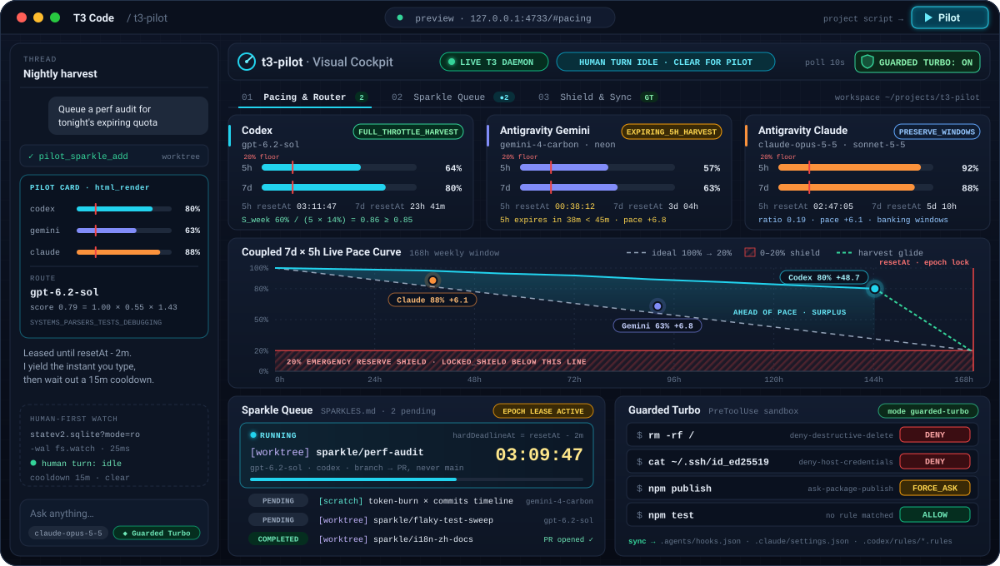
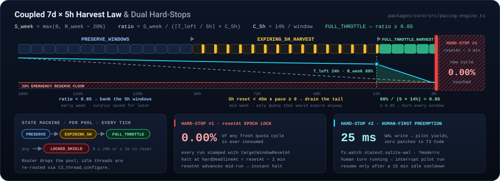
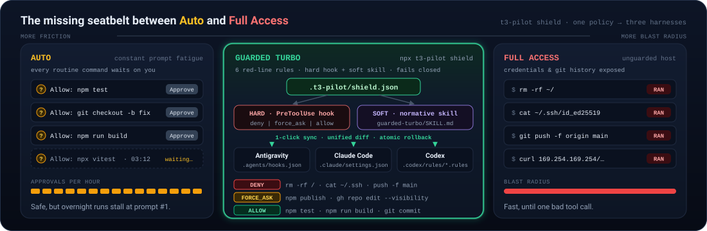
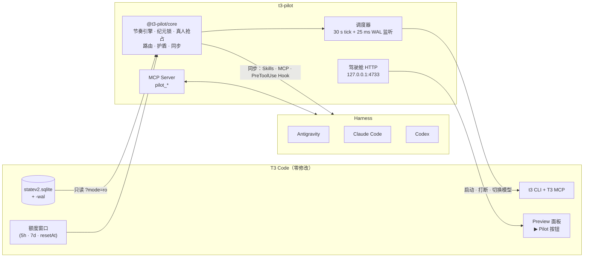

<div align="center">



# t3-pilot

**把快过期的 AI 额度变成第二天早上的惊喜，新周期的额度一分不碰。**

专为 [**T3 Code**](https://github.com/pingdotgg/t3code) 打造的 AI 额度自动驾驶：按任务匹配最合适、还有余量的模型，20% 紧急保底永远留着，临期额度拿去清 backlog，无人值守的 Agent 也有一条跨三端统一的安全带。

[English](./README.md) | **简体中文**

[](https://github.com/AgoodNA/t3-pilot/actions/workflows/ci.yml)
[](https://agoodna.github.io/t3-pilot/?demo=1)
[](./vitest.config.ts)
[](./package.json)
[](./LICENSE)

[快速开始](#-10-秒上手) · [三大核心能力](#-三大核心能力) · [驾驶舱](#-可视化驾驶舱与聊天内嵌卡片) · [CLI 与 MCP](#-cli-与-mcp-速查) · [安全保证](#-架构与安全保证) · [**直接试玩 →**](https://agoodna.github.io/t3-pilot/?demo=1)

</div>

---

## 🤔 为什么需要 `t3-pilot`？

在 T3 Code 里同时用好几家 AI 订阅（Claude、ChatGPT/Codex、Antigravity Gemini）的人，每家都要面对两套计量：**5 小时窗口**和 **7 天窗口**。结果一周下来，基本逃不出这三种剧本：

| | 这一周 | 代价 |
|---|---|---|
| 🐿️ **囤积型** | 一周都舍不得用，留着"以防万一" | 周日晚上 `resetAt` 一到，**大约 45% 的额度原地蒸发** |
| 🔥 **猛冲型** | 周二火力全开 | 周四 debug 到一半，**额度归零**，只能干等 |
| 🎰 **赌徒型** | 为了让通宵任务别卡在权限弹窗，直接开 **`Full Access`** | 然后整晚睡不踏实，脑子里全是 `rm -rf`、`~/.ssh` 和 `git push --force main` |

`t3-pilot` 一次性解决这三件事。它以**只读方式**读取 T3 Code 自己的额度遥测数据，精确算出每个额度池在过期前还能花多少，只把这部分拿去跑你提前排好的任务，并且在新周期开始前停下。

> [!NOTE]
> `t3-pilot` 不改 T3 Code 一行代码。`statev2.sqlite` 只用 `?mode=ro` 打开，线程和项目的任何改动**只**通过官方 `t3` CLI 和 T3 MCP 工具完成。

---

## ⚡ 10 秒上手

```bash
npx t3-pilot init   # 生成 .t3-pilot/、SPARKLES.md、Guarded Turbo 策略，并注册 Pilot 按钮
npx t3-pilot up     # 启动调度器 + 可视化驾驶舱：http://127.0.0.1:4733
```

就这两行。`init` 还会在 T3 Code 顶栏加一个 **`▶ Pilot`** 项目脚本（`npx t3-pilot up --port 4733`），点一下就在 T3 的 Preview 面板里打开驾驶舱。**macOS、Windows、SSH 连的远程 Linux VPS，以及 T3 Connect 手机端预览**上效果完全一样。

<details>
<summary><b><code>init</code> 会生成哪些文件</b>（只在文件不存在时创建，或加 <code>--force</code> 覆盖）</summary>

| 路径 | 用途 |
|---|---|
| `.t3-pilot/config.json` | 节奏参数：`reserveFloorPercent: 20`、`singleWindowCapacityPercent: 14`、`fullThrottleRatioThreshold: 0.85`、`expiringSessionThresholdMins: 45`、`epochSafetyMarginMins: 2`、`cooldownMinutes: 15`、`tickIntervalMs: 30000` |
| `SPARKLES.md` | 你的 Sparkle 队列，就是一个普通的 Markdown 待办清单 |
| `.t3-pilot/shield.json` | Guarded Turbo 策略（`mode: guarded-turbo`，受保护分支：`main`、`master`、`production`、`release/*`） |
| `.t3-pilot/skills/guarded-turbo/SKILL.md` | 自动生成的软约束 Skill（带哈希签名，策略变更时重新生成） |
| `.t3-pilot/skills/pilot-autopilot/SKILL.md` | 示例 Skill，会同步到所有 harness |
| `.t3-pilot/mcp.json` | 把 `npx t3-pilot mcp` 注册为所有 harness 的 MCP Server |

参数：`--port <n>` · `--project-id <id>` · `--base-branch <ref>` · `--no-install-script` · `--force` · `--json`
</details>

> [!TIP]
> 还没装 daemon？直接打开 **[在线交互演示](https://agoodna.github.io/t3-pilot/?demo=1)**。它和正式版是同一个驾驶舱，只是换成离线模拟引擎，内置 4 个场景可以切换：*Early-Week Cruise*（周初巡航）、*&lt;45m Expiring 5h Harvest*（5h 窗口临期收割）、*24h Left · 80% Full-Throttle*（最后 24 小时全速收割）、*&lt;=20% Reserve Shield Locked*（触发保底锁定）。

---

## 🚀 三大核心能力

### 1. `7d × 5h` 耦合临期额度盲盒收割机 + `resetAt` 零新额度铁律



这两个窗口是**互相牵制的**：5h 窗口决定你能花多快，7d 窗口决定你总共能花多少。到了周末，剩下的 5h 窗口数可能已经**不够**把周额度花完，哪怕每个窗口都跑满也不行。这时候再等"周日晚上"就晚了。`t3-pilot` 每次 tick 都会对每个额度池检查是否到了这个时刻：

```text
S_week  = max(0, R_week − 20%)                   # 扣掉保底线之后的周余量
N_5h    = ⌈T_left / 5h⌉                          # 距离周 resetAt 还剩几个 5h 窗口
ratio   = S_week / (N_5h × C_5h)                 # C_5h = 单个跑满的 5h 窗口约消耗 14% 周额度

ratio ≥ 0.85                                     → FULL_THROTTLE_HARVEST（全速收割）
5h resetAt < 45m  ∧  周节奏 ≥ 0  ∧  S_5h > 0      → EXPIRING_5H_HARVEST（只收割临期尾巴）
R_week ≤ 20%  ∨  R_5h ≤ 20%  ∨  距任一 reset ≤ 2m → LOCKED_SHIELD（保底锁定）
其余情况                                          → PRESERVE_WINDOWS（攒着）
```

**算一笔账：** 还剩 24 小时，周额度剩 80% → `S_week = 60%`，`N_5h = ⌈24/5⌉ = 5`，最大可消耗 `5 × 14% = 70%` → `ratio = 0.857 ≥ 0.85` → **全速收割**。就算跑满也很难花完，所以剩下的每一个窗口都会被用上。

**Sparkle 队列**就是这些余量的去处。把脑洞写进 `SPARKLES.md`（也可以在驾驶舱里加，或者让 Agent 调用 `pilot_sparkle_add`）：

```markdown
- [ ] [worktree] 审计 cockpit 打包体积，把优化项提成 PR
- [ ] [scratch]  做一个多 Agent token 消耗 vs git 提交的交互式时间线原型
```

| 模式 | 在哪儿跑 | 第二天早上你拿到什么 |
|---|---|---|
| `[worktree]` | 从 base 分支（默认 `main`）拉一个全新的 git worktree，分支名 `sparkle/<slug>` | 一个等你 review 的分支/PR，**绝不碰 `main`** |
| `[scratch]` | 独立目录 `.t3-pilot/scratch/<slug>/`，作为单独的 T3 项目运行 | 调研报告、一次性原型、Demo |

每次运行都有**两道绝对硬停**：

1. **`resetAt` 纪元锁：新周期额度消耗 0.00%。** 每个任务都会记下它所花窗口的重置时间（`targetWindowResetAt`），并算出 `hardDeadlineAt = min(resetAt) − 2 min`。到点精确到毫秒叫停；如果 T3 报告 `resetAt` 在运行中途推进了，也会立即叫停。2 分钟是**下限**：配置可以调大，不能调小。
2. **真人优先：约 25ms 内让出。** 调度器用 `fs.watch` 盯着 `statev2.sqlite`、`-wal` 和 `-journal`，去抖 **25ms**。T3 的 projection 表里一出现非 pilot 的真人 turn，pilot 任务立刻被打断，并等**空闲满 15 分钟**才恢复。你永远不用和自己的自动驾驶抢额度。

### 2. `Guarded Turbo`（`t3-pilot shield`）：跨三端 `PreToolUse` 安全带



`Auto` 连跑个 `npm test` 都要你点同意，通宵任务第一个弹窗就卡住；`Full Access` 则会毫不犹豫地执行 `cat ~/.ssh/id_ed25519`。**Guarded Turbo** 让日常操作全速放行，只在剩下的部分拉六条红线，而且每条都**双保险**：

- **硬拦截：** `PreToolUse` Hook（`.t3-pilot/hooks/guarded-turbo-hook.mjs`）会真正解析 shell 命令：拆开 `&&` / `;` / `|` 链，剥掉 `sudo` / `env` / `bash -c` 外壳，递归检查 `$(…)`，归一化 `~` / `$HOME` / `..`，再给出 `allow` / `deny` / `force_ask`。**失败即拒绝**：payload 解析不了，一律 `deny`。
- **软约束：** 自动生成的 `guarded-turbo/SKILL.md`，让 Agent 在动手**之前**就知道哪些事碰不得。

| 规则 ID | 默认 | 拦截示例 |
|---|---|---|
| `deny-destructive-delete` | 🛑 `deny` | `rm -rf /`、`~`、`..`、`.git`；`mkfs*`；`dd of=/dev/…`；`find / -delete`；对根目录/家目录/仓库根执行 `git clean -fdx` |
| `deny-host-credentials` | 🛑 `deny` | `~/.ssh`、`~/.aws`、`~/.gnupg`、`.netrc`、`.npmrc`、`.pypirc`、`.kube/config`、`gh/hosts.yml`、`.docker/config.json`、`/etc/shadow`、`/etc/sudoers`、`169.254.169.254`、`metadata.google.internal` |
| `deny-force-push-protected` | 🛑 `deny` | 对受保护分支执行 `git push --force` / `-f` / `--force-with-lease` / `--delete` / `+ref` / `:ref`，`--mirror`，`git branch -D main` |
| `deny-foreign-containers-and-firewall` | 🛑 `deny` | 修改 `ufw` / `iptables` / `nft` / `firewall-cmd`，`systemctl stop|disable|mask|kill`，`shutdown` / `reboot`，`docker|podman system/volume prune`，对非 `t3-pilot*` 容器执行 `rm` / `stop` / `kill` |
| `ask-package-publish` | ✋ `force_ask` | `npm` / `pnpm` / `yarn` / `bun` / `cargo` / `poetry publish`，`twine upload`，`docker push`，`gh release create` |
| `ask-public-repo-visibility` | ✋ `force_ask` | `gh repo create --public`、`gh repo edit --visibility`、`gh repo delete|archive`、`gh secret set|delete|remove` |

一份策略文件 **`.t3-pilot/shield.json`**，编译成三家 harness 各自的原生格式：

| Harness | 硬拦截 | 软约束 |
|---|---|---|
| **Antigravity** | `.agents/hooks.json` → `PreToolUse` → `allow \| deny \| force_ask` | `.agents/skills/guarded-turbo/SKILL.md` |
| **Claude Code** | `.claude/settings.json` → `PreToolUse` → `permissionDecision: allow \| deny \| ask` | `.claude/skills/guarded-turbo/SKILL.md` |
| **Codex** | `.codex/rules/t3-pilot-guarded-turbo.rules` → `prefix_rule(…, decision = "forbidden" \| "prompt")` | `.codex/skills/` + `.codex/GUARDED_TURBO.md` |

三种模式：`guarded-turbo`（默认）；`strict`（`npm test`、`npm run build|typecheck|lint`、`npx vitest`、只读 `git` 等本地开发白名单之外的 shell 命令，一律 `force_ask`）；`off`。

```bash
$ npx t3-pilot shield check --command "rm -rf /"
deny · Recursive forced deletes of root, home, parent or Git metadata, …
$ npx t3-pilot shield check --command "npm publish"
force_ask · Publishing packages, uploading registry artifacts or creating a GitHub release.
$ npx t3-pilot shield check --command "npm test"
allow · No Guarded Turbo rules matched.
```

### 3. 20% 紧急保底护盾 + 智能任务路由与一键三端同步

**保底护盾。** 任何额度池的周额度**或**当前 5h 窗口一旦降到 **≤ 20%**，立刻进入 `LOCKED_SHIELD`，自动路由和委派任务都不会再往这里派活。凌晨两点线上出 bug 时，你手里永远有一笔应急额度。保底线被钳制在 **≥ 20%**：配置只能往上调，不能往下调。确实需要时，人可以用 `route --manual-override` 主动破例。

**智能路由。** 每个候选模型的得分：

```text
score = TaskAffinity × SurplusFactor × UrgencyWeight

TaskAffinity  = 模型对该任务类别的契合度（0–1）
SurplusFactor = clamp(可燃余量% / 80, 0, 1)               # LOCKED_SHIELD 时为 0
UrgencyWeight = 1 + 0.5 × clamp(ratio, 0, 1.5)            # 越临期，越优先用掉
```

| 模型 | 额度池 | UI / 前端 / 长文 | 系统 / 解析器 / 测试 | 样板 / 文档 / 翻译 | 架构编排 |
|---|---|:-:|:-:|:-:|:-:|
| `gpt-6.2-sol` | Codex | 0.35 | **1.00** | 0.45 | 0.65 |
| `claude-opus-5-5` | Antigravity Claude | **1.00** | 0.36 | 0.48 | **1.00** |
| `claude-sonnet-5-5` | Antigravity Claude | 0.97 | 0.35 | 0.55 | 0.95 |
| `gemini-4-carbon` | Antigravity Gemini | 0.90 | 0.35 | 0.55 | 0.94 |
| `gemini-4-neon` | Antigravity Gemini | 0.86 | 0.32 | 0.62 | 0.90 |
| `gemini-3.8-flash` | Antigravity Gemini | 0.45 | 0.23 | **1.00** | 0.48 |

```bash
$ npx t3-pilot route "fix the flaky sqlite parser test"
gpt-6.2-sol · codex
```

按头图里的额度状态算：Codex 得分 `1.00 × 0.55 × 1.43 = 0.79`（契合度 × 44% 可燃余量 / 80 × ratio 0.86 对应的紧迫度），`claude-opus-5-5` 只有 `0.36 × 0.85 × 1.09 = 0.33`。

切换模型只发生在**空闲**线程上、两个 turn 之间，通过 `t3_thread_configure` 完成，绝不打断正在进行的 turn。

**一键三端同步。** `.t3-pilot/` 是 Skills、MCP Server 和 Guarded Turbo 策略的唯一来源。`sync --diff` 先给你看每个要改的文件的 unified diff；`sync --apply` 原子写入，并在 `.t3-pilot/backups/` 留快照；`sync --rollback [snapshotId]` 一键回滚。

| 来源 | → Antigravity | → Claude Code | → Codex |
|---|---|---|---|
| `.t3-pilot/skills/` | `.agents/skills/` | `.claude/skills/` | `.codex/skills/` |
| `.t3-pilot/mcp.json` | `.agents/mcp_config.json` | `.mcp.json` | `.codex/config.toml` |
| `.t3-pilot/shield.json` | `.agents/hooks.json` | `.claude/settings.json` | `.codex/rules/t3-pilot-guarded-turbo.rules` |

---

## 🛫 可视化驾驶舱与聊天内嵌卡片

```bash
npx t3-pilot up                      # 驾驶舱 + 调度器，监听 127.0.0.1:4733
npx t3-pilot up --once --dry-run     # 只跑一次 tick：做决策，但不真的启动任务
npx t3-pilot card                    # 输出自包含 HTML 卡片，直接喂给 T3 的 html_render
```

驾驶舱是一个零 CDN、可离线运行的 React 应用，分三个视图：

- **`01 Pacing & Router`**：每个额度池一张卡片，带 5h/7d 进度条、红色 **20% 保底刻度**、收割模式徽章和 `resetAt` 倒计时；168 小时的 **`7d × 5h` 耦合实时节奏曲线**（红色 0–20% 护盾区、`100% → 20%` 理想滑翔虚线、各池实时标记点）；外加一个路由测试器。
- **`02 Sparkle Queue`**：添加、查看、跟踪 Sparkle 任务，实时倒计时到 `hardDeadlineAt`，状态有 `RUNNING · EPOCH LOCK · PREEMPTED · COMPLETED`。
- **`03 Shield & Sync`**：Guarded Turbo 开关面板（模式与逐条规则开关）、可以随便输命令试拦截效果的 `PreToolUse` 沙箱，以及同步的 diff / apply / rollback 面板。

顶部命令栏实时显示 `LIVE T3 DAEMON`、`HUMAN TURN IDLE · CLEAR FOR PILOT`（或 `PREEMPTED` / 冷却中）和当前护盾模式。任意驾驶舱 URL 加上 **`?demo=1`** 就会强制进入离线模拟，[GitHub Pages 在线演示](https://agoodna.github.io/t3-pilot/?demo=1)就是这样跑的。

---

## 📖 CLI 与 MCP 速查

### CLI：`npx t3-pilot <command>`

| 命令 | 参数 | 作用 |
|---|---|---|
| `init` | `--port <n>` `--project-id <id>` `--base-branch <ref>` `--no-install-script` `--force` `--json` | 生成 `.t3-pilot/` 和 `SPARKLES.md`，注册 **Pilot** 按钮 |
| `status` | `--json` | 各池收割模式与可燃余量、真人抢占状态、待跑 Sparkle、当前任务 |
| `route <task…>` | `--manual-override` `--json` | 给任务分类并给模型排名（override 可以选被护盾锁定的池） |
| `up` | `--once` `--dry-run` `--port <n>` `--host <ip>` `--allow-remote` `--json` | 运行调度器并提供驾驶舱（不加 `--allow-remote` 只监听回环地址） |
| `sparkle list` | `--json` | 查看队列 |
| `sparkle add <title…>` | `--mode worktree\|scratch` `--prompt <text>` `--json` | 追加到 `SPARKLES.md` |
| `sparkle run-once` | `--dry-run` `--json` | 立即跑一次调度 tick |
| `shield status` | `--json` | 当前模式与每条规则的决策 |
| `shield mode <m>` | `guarded-turbo\|strict\|off` `--json` | 切换模式 |
| `shield toggle <ruleId>` | `--enable` \| `--disable` · `--decision allow\|deny\|force_ask` · `--json` | 开关某条规则或修改其决策 |
| `shield check` | `--tool <name>` `--command <cmd>` `--path <file>` `--json` | 用当前策略试判一次工具调用 |
| `shield evaluate` | `--harness antigravity\|claude-code\|generic` | Hook 入口：从 stdin 读 `PreToolUse` payload，输出对应 harness 的原生决策 |
| `sync` | `--diff` \| `--apply` \| `--rollback [snapshotId]` · `--targets antigravity,codex,claude-code` · `--json` | 预览、应用或回滚三端同步（默认 `--diff`） |
| `card` | 无 | 输出聊天内嵌 HTML 状态卡片 |
| `mcp` | 无 | 启动 stdio MCP Server |

### MCP 工具（`npx t3-pilot mcp`）

| 工具 | 作用 |
|---|---|
| `pilot_status` | 实时 5h & 7d 额度池、耦合收割模式、20% 保底护盾、真人抢占状态、Sparkle 队列 |
| `pilot_route` | 按 任务契合度 × 可燃余量 × 重置紧迫度 给模型打分，严格遵守 20% 护盾 |
| `pilot_sparkle_add` | 把一个点子以 `worktree` 或 `scratch` 模式追加到 `SPARKLES.md` |
| `pilot_shield` | 读取 Guarded Turbo 策略，或评估一次拟执行的工具调用 |
| `pilot_sync` | 预览（`dryRun`）、应用或回滚 Skills / MCP / Guarded Turbo 同步 |

---

## 🔐 架构与安全保证



| 保证 | 实现方式 |
|---|---|
| **绝不写 T3 数据库** | `statev2.sqlite` 只以 `file:…?mode=ro` 打开；线程/项目变更全部走官方 `t3` CLI 或 T3 MCP 工具（`t3_thread_launch`、`t3_thread_interrupt`、`t3_thread_configure`、`t3_project_update`） |
| **新周期额度 0.00%** | 每个任务都有 `hardDeadlineAt = min(resetAt) − 2 min`，`resetAt` 一推进立即叫停；安全边际不能配置到 2 分钟以下 |
| **真人永远优先** | 25ms WAL 监听 → 打断 pilot 任务 → 15 分钟冷却；pilot 自己的线程不计入检测 |
| **保底绝不动用** | 周额度或 5h 额度 ≤ 20% 的池直接 `LOCKED_SHIELD`；保底线不能配置到 20% 以下 |
| **Sparkle 伤不到 `main`** | `[worktree]` 跑在 `sparkle/<slug>` 分支，`[scratch]` 跑在 `.t3-pilot/scratch/`；Guarded Turbo 拒绝任何对 `main` / `master` / `production` / `release/*` 的强推 |
| **Hook 失败即拒绝** | `PreToolUse` payload 解析失败 → `deny` |
| **驾驶舱 API 仅限本机** | 默认绑定 `127.0.0.1`，非回环 `--host` 必须显式加 `--allow-remote`。所有写操作 `POST /api/{route,sparkle,shield,sync}` 都必须来自回环连接（除非 `--allow-remote`），**并且**带上 `X-Pilot-Token` 请求头。Token 是每次启动随机生成的 32 字节密钥，用 `timingSafeEqual` 做常量时间比对，恶意网页或配错的反向代理都没法操控你的自动驾驶 |
| **同步可回滚** | 每次 `sync --apply` 前先做原子快照，`sync --rollback` 一键恢复 |

<details>
<summary><b>Monorepo 结构</b></summary>

| 包 | 内容 |
|---|---|
| [`packages/core`](./packages/core/src) | 额度读取、`7d × 5h` 耦合节奏引擎、纪元锁、真人抢占、任务路由、Guarded Turbo 策略引擎、Skills / MCP / Hooks 转译器 |
| [`packages/daemon`](./packages/daemon/src) | `t3-pilot` CLI、调度器、MCP Server、驾驶舱 HTTP 服务、T3 适配器与安装器、聊天卡片 |
| [`apps/cockpit`](./apps/cockpit/src) | 零 CDN React 驾驶舱，同时构建为 GitHub Pages 在线演示 |

```bash
npm test          # core、daemon、cockpit 全量 Vitest
npm run typecheck
npm run build
```
</details>

---

## 🧭 支持的 Provider

已在 T3 Code 中针对 **Codex**（`gpt-6.2-sol`）、**Antigravity Gemini**（`gemini-4-carbon`、`gemini-4-neon`、`gemini-3.8-flash`）和 **Antigravity Claude**（`claude-opus-5-5`、`claude-sonnet-5-5`）完成开发与测试。在 T3 之外上报额度的池会显示为 `EXTERNAL_UNMETERED`，按 0.5 的余量系数参与路由。同步和 Hook 输出同样覆盖 Claude Code 原生的 `.claude/` 目录结构，本地用 Claude Code 的同学也能拿到同一份 Guarded Turbo 策略。欢迎提 PR 接入更多 adapter。

## 📄 许可证

[MIT](./LICENSE)。为 T3 Code 社区而做。如果 `t3-pilot` 帮你省下了一个周日晚上的额度，点个 ⭐ 能让更多人看到它。
