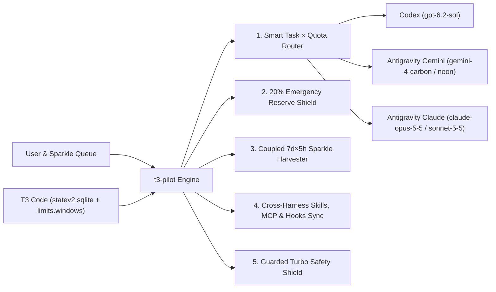

# `t3-pilot` — Product & Architecture Blueprint

> **One-liner**: Turn expiring AI quota into morning surprises — without touching 1% of your fresh cycle. Smart task-to-model routing, a 20% emergency reserve shield, a coupled `7d × 5h` expiring-quota **Sparkle Queue**, **Guarded Turbo** cross-harness safety rails, and 1-click Skills/MCP/Hooks sync built natively for **T3 Code**.

> [!TIP]
> **Blue-Ocean Verification**: `pingdotgg/t3code` has **74,240+ ⭐**, yet searching GitHub for third-party T3 Code quota/autopilot/sync tools returns **0 repositories**, and `npx t3-pilot` is **available** on npm.

---

## 1. Core Value Pillars

### Pillar 1: Visual Pilot Cockpit (Inside T3 Preview + Chat Cards)
- Registers a top-bar **`Pilot`** project button in T3 Code (`scripts` integration) opening a live split-pane dashboard (works identically on macOS, Windows, remote SSH Linux, and T3 Mobile).
- Also renders inline interactive quota & routing cards via T3's `html_render` MCP tool.
- Displays unified **5-hour window %**, **7-day weekly %**, **Reset countdown (`resetAt`)**, **Live Pace Curve**, **Sparkle Queue Manager**, and **Guarded Turbo Safety Shield switches** across `Codex`, `Antigravity (Gemini)`, and `Antigravity (Claude)` (with plug-and-play adapter stubs for native `claudeAgent` / `cursor` on community request).

### Pillar 2: Task-Fit × Surplus Smart Model Router + 20% Reserve Shield
- Classifies incoming tasks (`UI/Frontend & Long-form` $\rightarrow$ Claude Opus/Sonnet 5.5 or Gemini 4 Carbon/Neon; `Systems/Parsers/Tests/Debugging` $\rightarrow$ Codex `gpt-6.2-sol`; `Boilerplate/Docs/Translations` $\rightarrow$ `gemini-3.8-flash` / low effort).
- Multiplies **Task-Affinity Score $\times$ Burnable Surplus Above 20% Floor** weighted by proximity to `resetAt`.
- **20% Reserve Shield**: Once any pool reaches `<= 20%` weekly (or active 5h) remaining, `t3-pilot` locks out automatic/delegated routing to that pool (switching idle threads between turns via `t3_thread_configure`, never interrupting mid-turn). Manual user overrides remain allowed for emergencies via CLI.

### Pillar 3: Coupled `7d × 5h` Expiring-Quota "Sparkle Engine" (垃圾额度造惊喜)
- **Sparkle Queue (`SPARKLES.md` + Cockpit UI + GitHub Issues)**: Drop daily brainstorms, wild "what-if" prototypes, or backlog sweeps:
  - **Repo Worktree Mode**: Runs in an isolated git worktree (`workspaceStrategy: "worktree"`) and opens a branch/PR—never touches `main`.
  - **Standalone Scratch Mode**: Auto-creates an isolated scratch workspace for pure research reports or interactive demos.
- **Coupled `7d × 5h` Harvest Law**:
  - Let weekly burnable surplus be $S_{\text{week}} = \max(0, R_{\text{week}} - 20\%)$, time to weekly reset be $T_{\text{left}}$, and single 5h window drain capacity be $C_{5\text{h}}$.
  - Early in the week, preserves 5h windows. Once $S_{\text{week}}$ approaches or exceeds $\lceil T_{\text{left}} / 5 \rceil \cdot C_{5\text{h}}$ (meaning you *cannot* spend the remaining weekly quota even at max 5h pace—e.g. 24h left with 80% weekly remaining), enters **Full-Throttle Harvest Mode** across every remaining 5h window.
  - Also harvests expiring idle 5h windows (`< 45m` to 5h reset) when weekly pace has surplus, while automatically treating past-due `sessionWindow.resetsAt` (`now >= sessionReset`) as freshly restored to `100%`.
- **Two Absolute Hard-Stops**:
  1. **Zero-Fresh-Quota Guarantee (`resetAt` Epoch Lock)**: Stamps every run with `targetWindowResetAt`. Within `(0, 2 min]` before `resetAt` (or the instant `resetAt` advances to the new cycle), **immediately halts** so **0.00% of refreshed quota is ever consumed**.
  2. **Human-First Instant Preemption**: Watches T3's `orchestration_v2_projection_runs` / `projection_threads`; the instant a human-initiated turn starts running, `t3-pilot` pauses/yields immediately so it never competes with active work, resuming only after configurable idle cooldown (default `15 min`).

### Pillar 4: Guarded Turbo Safety Layer (`t3-pilot shield` — `Auto` 与 `Full Access` 之间的安全巡航层)
- Bridges the gap between `Auto` (noisy permission prompts on routine dev commands) and `Full Access` (unguarded catastrophic host exposure) through **Dual Insurance: Hard-Intercept `PreToolUse` Hooks + Soft-Normative `guarded-turbo` Skill (`SKILL.md`)**:
  - **Hard Red-Line Blocks (`deny` / `forbidden`)**: Catastrophic deletes (`rm -rf /`, `~`, `.git`, `mkfs`, `dd`), host credential & secret reads (`~/.ssh`, `~/.aws`, `~/.gnupg`, `/etc/shadow`, cloud IMDS), force-pushing protected branches (`main`/`master`/`production`), and mutating non-project containers, host firewalls (`ufw`/`iptables`/`nft`), or system services.
  - **Sensitive Human Escalations (`force_ask` / `ask` / `prompt`)**: Package/registry publishing (`npm publish`, `cargo publish`, `docker push`, `gh release create`) and repository visibility or destructive remote changes (`gh repo edit --visibility public`, `gh repo delete`).
  - **Fast Allowlist Cruise (`allow`)**: Routine workspace builds, tests, typechecks, and local git branch operations run at full speed without friction.

### Pillar 5: 1-Click Cross-Harness Skills, MCP & Guarded Turbo Sync
- Single source of truth (`.t3-pilot/skills/`, `.t3-pilot/mcp.json`, and `.t3-pilot/shield.json`) compiled & synced cleanly across **Antigravity** (`.agents/skills/`, `.agents/mcp_config.json`, `.agents/hooks.json` `PreToolUse: allow | deny | force_ask`), **Claude Code** (`.claude/skills/`, `.mcp.json`, `.claude/settings.json` `PreToolUse`), and **Codex** (`.codex/skills/` + `agents/openai.yaml`, `.codex/config.toml`, `.codex/rules/t3-pilot-guarded-turbo.rules`) with unified diff preview and atomic rollback.

---

## 2. Monorepo Layout (`t3-pilot/`)

- `packages/core`: Quota window reader (T3 caches + multi-root Codex session telemetry), Coupled `7d × 5h` math engine, Task-to-Model scorer, Human-activity detector, Guarded Turbo policy engine, and Skills/MCP/Hooks transpiler (100% unit-tested).
- `packages/daemon`: Background governor + MCP server (`pilot_status`, `pilot_route`, `pilot_sparkle_add`, `pilot_sync`, `pilot_shield`) + CLI (`npx t3-pilot init | status | route | up | sparkle | shield | sync | mcp`).
- `apps/cockpit`: Lightweight zero-external-CDNs Vite + React split-pane dashboard (Pacing Dashboard, Sparkle Queue Manager, Guarded Turbo Shield Switchboard) rendered inside T3 Preview pane & exportable as a live GitHub Pages interactive demo.

---

## 3. Multi-Model Build Plan (Enforcing 20% Weekly Floor)

| Milestone | Scope | Primary Model Assignment |
|---|---|---|
| **M1: Core Engine & Tests** | T3 SQLite/limits reader, Coupled `7d×5h` math, `resetAt` epoch lock, human preemption, Guarded Turbo policy & Skills/MCP/Hooks sync engine + Vitest suite | **Codex (`gpt-6.2-sol`)** |
| **M2: Daemon, CLI & T3 MCP Integration** | `npx t3-pilot` CLI (`shield` included), MCP server tools, T3 top-bar `Pilot` script installer, Worktree/Scratch Sparkle runner | **Codex (`gpt-6.2-sol`)** + **Gemini 4 Carbon** |
| **M3: Visual Cockpit & Chat Cards** | Split-pane T3 Cockpit UI (`apps/cockpit`: Pacing + Sparkle Queue + Guarded Turbo Panel), `html_render` inline quota/surprise cards, interactive GitHub Pages live demo | **Antigravity Claude (`claude-sonnet-5-5` / `opus-5-5`)** + **Gemini 4 Neon/Carbon** |
| **M4: Viral Launch Polish** | Animated terminal + Cockpit GIFs, bilingual EN/ZH README, Show HN / Reddit / T3 community launch kit, flip `AgoodNA/t3-pilot` Public | **Claude Opus 5.5 (via Antigravity)** + **Gemini 3.8 Flash** |
